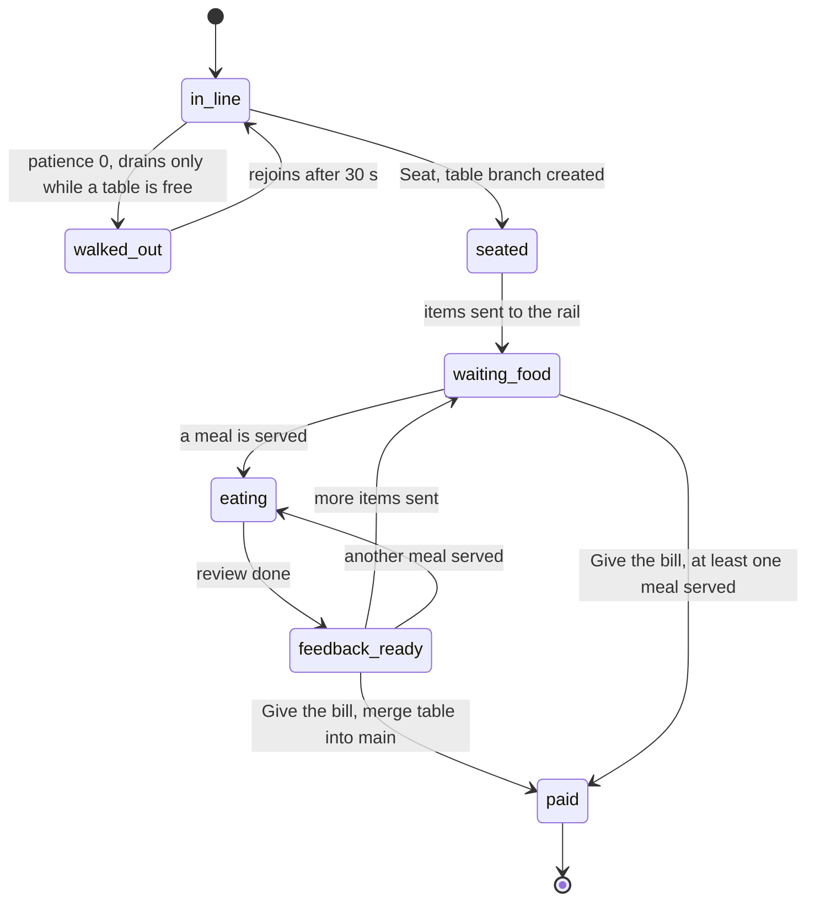
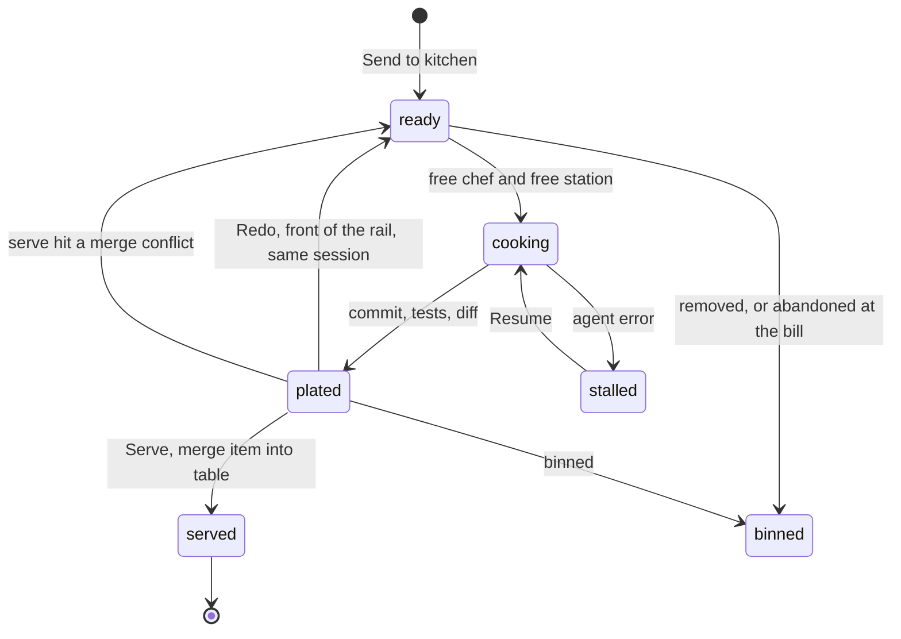
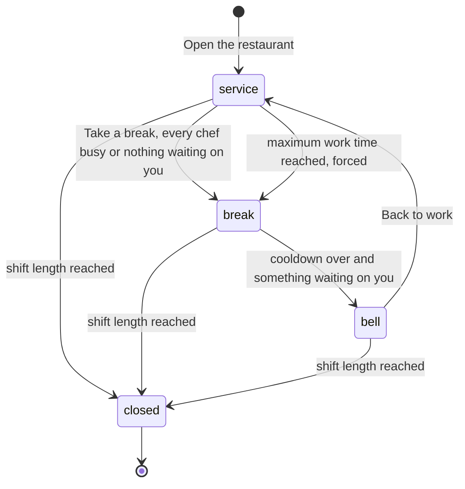

# Ship Shift: Project Specification

Tanda AI Hackathon 2026, "Bring an idea to life". Draft for team review, written Saturday 21 November 2026, about 11:15am. The link is due in #showcase at **4:30pm**; demos start at **5:00pm**.

## Decisions confirmed (21 November, 12:05pm)

- **D9 (the team's choice):** every agent runs on Claude Haiku (`claude-haiku-5-5`), with spend and message caps.
- **Every other decision in Appendix A:** the recommended default.

The implementation follows this spec. See `README.md` for how to run, configure and host it.

## How to use this document (for the implementing AI agent)

1. Read this spec fully, then `README.md` and the code under `server/` and `public/`. A working prototype already exists in this repo: Ship Shift with a *head chef* player. This spec redirects it to the team's *waiter* design. Where `docs/plan.md` disagrees with this spec, this spec wins.
2. The team's design in Sections 2 to 6 is the source of truth. Do not remove a feature the team defined. Where this spec offers an alternative, it is labelled **Suggestion** and the team's version stays the default.
3. Before writing code, ask the team the open decisions in **Appendix A**, all in one batch. Use the recommended default for anything they skip.
4. Build in priority order:
   - **P0:** the demo fails without it.
   - **P1:** clearly improves the demo. Start only when P0 works end to end in simulated mode.
   - **P2:** stretch or future work. Start only after P0 and P1 are deployed.
5. Keep the server and client contract (Section 7.6) identical on both sides. It is the seam that lets teammates, and their agents, work in parallel.
6. Never commit an API key. Run `npm run check` and the smoke test before every push. Work on a feature branch and commit in small steps.

---

## 1. Project name and tagline

**Name:** Ship Shift. Keep it: it is already in the code, the UI and the hosting configs. Alternatives are *The Pass* or *Smoko* (Australian slang for a work break); see D13.

**Tagline:** *Your agents cook. You run the floor. You still get your break.*

**One-line pitch:** Claude writes the code; Ship Shift decides when your attention is spent on it.

**Elevator pitch:** When you run three to five coding agents at once, the bottleneck stops being the model and becomes you:

- which agent is stuck,
- which result you haven't read,
- when you last stood up.

Ship Shift turns that juggling into a restaurant. Your agents are the customers who order work and the chefs who cook it. You are the waiter: you break orders down, taste every dish before it goes out, and take a real break while the kitchen is busy. A bell calls you back only when something needs you.

---

## 2. Overview

Ship Shift is a browser game that is also a working front end for running several AI coding agents in parallel. It plays as a top-down restaurant, in the style of Overcooked but calmer and built for tapping.

- **Customers are AI reviewer agents.** Each brings a task, shown like a GitHub Issue or Jira ticket. Later the customer tests and reviews the result against that original ticket.
- **Chefs are AI coding agents** (Claude Agent SDK sessions). Each chef:
  - works one small task at a time, in its own git worktree;
  - cooks at a **work station** (Backend, Frontend, Database or Integration);
  - gets that station's system prompt added to its instructions.
- **The player is the waiter (the expediter).** The waiter:
  1. chooses which customer to seat;
  2. breaks the order into station-scoped **items** (prompts);
  3. samples each finished **meal**: the real diff, the test results and the chef's summary;
  4. sends the meal back, or serves it with a note;
  5. hears the customer's feedback;
  6. decides when the task is complete. That is **the bill**: the work is merged into main.
- **Shifts work like a Pomodoro timer.**
  - When the kitchen is fully busy, the waiter can take a break.
  - A cooldown the player sets protects the break.
  - After the cooldown, a **bell** calls the waiter back once results are ready. Only then do patience meters start to drain.
  - A maximum work time forces a break if the player never stops.

The restaurant is a skin over a real queue. Every customer, ticket, plate and score point comes from real state: git branches and merges, test runs, and agent or reviewer output. A plain "pro view" (`/board.html`) shows the same state without the art.

### For the hackathon

- **Every visitor gets a private restaurant.** Opening the link on a phone creates one, with its own copy of a small example project: a cafe rostering and pay app, which is on brand for Tanda.
- **Chefs are simulated by default.** They are scripted, but they make real file edits, real commits, real test runs and real merges. A full order fits in two minutes and costs nothing.
- **Customer reviews can be written by real Claude**, on the team's capped API key.
- **Visitors with their own API key can hire real Claude chefs.**
- **The team runs a flagship restaurant with real agents** that anyone can watch.

### Metaphor map

Use these terms consistently in the UI, the code and the pitch.

| Restaurant | Software meaning | Code name / mechanism |
|---|---|---|
| Customer in line | A ticket in the backlog | `customer` with `state: 'in_line'`; static data shaped like an issue |
| Seating a customer | Accepting the task | `seat`: creates table branch `table/<id>-<slug>` from main |
| Order | The top-level task | `customer.title/body/acceptance/difficulty` |
| Item (a line on the order pad) | A sub-task prompt for one station | `item { station, prompt }` |
| Ticket rail | Work queue | `rail`: items in state `ready` |
| Chef | Coding agent | `chef`: Agent SDK session (real) or scripted chef (sim) |
| Work station | Agent specialisation | Station system prompt appended to the chef's prompt |
| Cooking | The agent at work | Live tool feed: reads, edits, commands |
| Oven lamp (green/red) | Test run | The project's test command |
| Meal on the counter | Agent output awaiting review | Item state `plated`: diff, tests, summary |
| Sampling the meal | Human code review | Diff viewer with "seen" tracking |
| Redo | Request changes | Resume the same agent session with feedback |
| Serve | Accept into the feature | Merge the item branch into the table branch, plus the waiter's note |
| Customer eats | Automated review against the ticket | Reviewer call: Claude (real) or scripted (sim) |
| Feedback at the table | Review comments | Verdict, satisfaction 1 to 5, text, suggested next items |
| The bill | Task done | Merge the table branch into main. The receipt shows the merge commit |
| Patience meter | Time an agent is blocked on the human | Drains only while the waiter is the bottleneck |
| Staff break, bell | Pomodoro rest and call-back | Shift phases `break` and `bell` |

### Design principles

1. **Attention is the scarce resource.** A patience meter drains only while the waiter is the bottleneck, and only once the waiter is on shift or has been called back. Waiting on a chef never drains a customer's patience.
2. **The kitchen is a skin over a real queue.** With the art removed, the board view must still run the restaurant. This answers the worry that the novelty fades.
3. **Nothing is done until it's tasted.** Serving without opening the diff is a "blind serve" and costs points. This answers half-hearted reviews.
4. **Rest is part of the loop.** An eligible break earns points; working past the limit costs them. This answers rewards that push the wrong behaviour.
5. **Real where it counts, simulated where it would break the demo.** This answers agent latency during a two-minute slot.

---

## 3. Objectives and user stories

### Objectives

- **O1.** Show that a game interface manages several concurrent agents better than a pile of chat tabs: one view of what is waiting on you, with work routed automatically.
- **O2.** Enforce review discipline. Every agent output is reviewed twice before it is done: by the human (sampling) and by a reviewer agent (the customer).
- **O3.** Protect human focus and rest with batched call-backs, protected breaks and a work-time cap.
- **O4.** Let anyone in the room play on their own phone within two minutes, with real work happening underneath.
- **O5.** Stay inside the team's US$150 API budget and keep the key secret. The kickoff warns: "your app's users spend it too: cap requests".

### User stories

| ID | As a… | I want… | So that… | Met by |
|---|---|---|---|---|
| US-1 | developer running several agents | to see at a glance which agents are cooking, waiting on me, or done | I stop tab-switching between terminals | Restaurant floor, patience meters, "waiting on you" meter, board view |
| US-2 | developer | to split a ticket into small station-scoped prompts | each agent gets one focused job | Order pad with stations, presets and free text |
| US-3 | developer | free agents to pick up the next task by themselves | no agent sits idle while I'm busy | Ticket rail with automatic chef pickup |
| US-4 | developer | to read every result before it goes further | I never accept work I haven't read | Sampling panel, blind-serve penalty, redo |
| US-5 | developer | an automated reviewer to check results against the original ticket | quality doesn't depend only on me | Customer review with verdict and feedback |
| US-6 | developer | a protected break while the kitchen is busy, and a call-back only when something needs me | I rest without missing anything | Break eligibility, cooldown, bell, patience that starts at the bell |
| US-7 | developer | to be stopped when I've worked too long | I don't burn out | Maximum work time and forced break |
| US-8 | developer | feedback on my rhythm, and eventually a recommended shift length | I learn my sustainable pace | Shift report (P0); history and recommendation (P2) |
| US-9 | judge or crowd member with a phone | to open a link and finish a full order in two minutes without instructions | I can judge it by playing it | Private restaurant, presets, short timers, first-run hints, touch UI |
| US-10 | judge | proof it's real | I trust it isn't a mock-up | Real commits, merges and tests; receipt with commit hash; real Claude reviews; flagship with real agents |
| US-11 | visitor with an API key | to hire real Claude chefs | I can watch real agents cook my orders | Bring-your-own-key dialog |
| US-12 | spectator | to watch the team's real-agent restaurant and a leaderboard | I can follow along without playing | Flagship watch mode, leaderboard |
| US-13 | team | the shared key hidden and spending capped | we don't leak the key or blow the budget | Key kept on the server, per-session and global caps, kill switch |
| US-14 | team | the demo to play the same way every time | the pitch is predictable | Deterministic simulated chefs and customers, a fresh repo per session |

---

## 4. Functional and non-functional requirements

Each requirement is tagged P0, P1 or P2 as defined in "How to use this document".

### 4.1 Restaurant and capacity

- **FR-1 (P0)** Each restaurant has:
  - 2 chefs and 2 usable tables, configurable with `SHIP_CHEFS` and `SHIP_TABLES`;
  - 4 work stations: Backend, Frontend, Database, Integration;
  - a ticket rail (ready queue) and a pickup counter (finished meals);
  - a line of customers outside.
- **FR-2 (P0)** The layout follows the team sketch (Section 6.1): kitchen on the left, the pass between kitchen and dining room, tables in the middle, the entry door and the customer line on the right.
- **FR-3 (P0)** When a session starts, all five demo customers (Section 8.2) are already in line, in a fixed order.

### 4.2 The line and seating

- **FR-4 (P0)** Tapping a customer in line opens a ticket preview showing:
  - issue key, title, description and acceptance criteria;
  - labels and difficulty (S/M/L);
  - the reviewer persona, their strictness, and their patience.
- **FR-5 (P0)** The waiter can seat the next customer (a "Seat next" button at the door) or any particular customer, if a table is free. Seating accepts the order: it creates the table branch and starts the "waiting to order" patience.
- **FR-6 (P0)** Line patience drains only while a table is free, meaning you could seat them but haven't. At zero, the customer walks out (−25 points) and rejoins the end of the line 30 seconds later (demo timing). In real use the ticket would still be in the backlog.
- **FR-7 (P1)** A "New customer" button lets the flagship and bring-your-own-key restaurants write their own ticket (title, body, difficulty). It is hidden in fully simulated sessions, where simulated chefs only know the demo recipes.

### 4.3 Breaking down the order (the order pad)

- **FR-8 (P0)** At a seated customer's table, the waiter opens the order pad: the ticket summary, then item lines. Each item is a station plus prompt text.
- **FR-9 (P0)** Each demo order offers 1 to 3 preset items, the "specials":
  - shown as tappable chips with the station preselected and editable text;
  - plus a "Write your own" line with a station picker, limited to 600 characters.
- **FR-10 (P0)** "Send to kitchen" puts the items on the rail, animated as the waiter carrying the tickets over.
  - At most 4 items per send.
  - An order can get more items later, after feedback.
- **FR-11 (P1)** While an item is still on the rail, not yet picked up, the waiter can edit or remove it.
- **FR-12 (P1)** Items the customer asked for in feedback (`missing`) appear as chips the next time the order pad opens.
- **FR-13 (P0)** Items are cut from the table branch at the moment a chef picks them up, so an item picked up after an earlier one was served builds on it. To sequence dependent work, the waiter sends the next item after serving the first. This is the "accept a sub-task to unlock the next step" loop from the original idea.

### 4.4 The rail, chefs and stations

- **FR-14 (P0)** Idle chefs pick up work automatically. A chef takes the oldest item on the rail whose station is free, since only one chef can use a station at a time (D5); redo items go first. The chef walks to the station, about 1 second, and starts cooking.
- **FR-15 (P0)** Each station appends its own system prompt (Section 7.5) to the chef's instructions. The chef's prompt is assembled from:
  - the order context,
  - the item text,
  - any waiter's note,
  - feedback from earlier rounds.
- **FR-16 (P0)** Each item cooks in its own git worktree, on branch `kitchen/<customerId>.<n>-<slug>`, cut from the table branch (D4).
- **FR-17 (P0)** Cooking shows a progress ring and a live tool feed at the station, for example "reads src/pay.js", "edits src/pay.js", "runs npm test". Tapping a cooking station opens a peek panel with the feed and the work-in-progress diff (the existing "taste" feature).
- **FR-18 (P0)** When a chef finishes, the server:
  1. commits the work;
  2. runs the project's tests, which light the oven lamp green or red;
  3. diffs the branch against the table branch;
  4. puts the meal on the counter.

  The chef becomes idle and picks up the next item.
- **FR-19 (P1, real chefs only)** Chef questions and permission requests (the existing "?" bubble) appear over the chef and are answered by tapping.
  - They are off in simulated demo sessions (D11).
  - In public sessions, requests outside the safe command policy are denied automatically (Section 7.9).

### 4.5 Sampling and serving

- **FR-20 (P0)** Tapping the counter opens the sampling panel for the oldest meal. It shows:
  - the item and order titles, the station and the chef;
  - the test result, with collapsible output;
  - the chef's summary;
  - the diff, hunk by hunk and readable on a phone;
  - how long the meal has waited.
- **FR-21 (P0)** A meal counts as sampled once every hunk has scrolled into view. This tracking already exists in `public/game/panels.js`.
- **FR-22 (P0)** **Redo** needs a short comment: quick chips ("Tests are failing", "Missed an edge case", "Changed too much") or free text. The item goes to the front of the rail, and the next free chef resumes the same agent session with the feedback.
- **FR-23 (P0)** **Serve** takes an optional note for the customer, up to 300 characters.
  - Serving merges the item branch into the table branch.
  - The waiter carries the plate to the table (animation) and the customer starts reviewing.
  - On a merge conflict, the item goes back to the rail with instructions to merge the table branch and resolve the conflict. This is the existing "spoiled plate" logic.
- **FR-24 (P0)** Serving a meal with failing tests is allowed but costs points. Serving without sampling is a blind serve (Section 6.6).

### 4.6 Customer review and feedback

- **FR-25 (P0)** After a serve, the customer "eats", which means reviewing.
  - **Inputs:** the ticket and its acceptance criteria; every item served so far (station, prompt, chef summary, waiter's notes); the latest test run on the table branch; and the table branch diff against main.
  - **Output:** `{ verdict: 'satisfied' | 'needs_more', satisfaction: 1–5, feedback (≤ 60 words, in character), missing: up to 3 × { station, prompt } }`.
- **FR-26 (P0 simulated, P1 real)** Simulated customers return scripted reviews, keyed by order and by which items have been served (Section 8.2). Real customers call Claude (Section 7.5). A real review falls back to the scripted one, and is logged, when any of these happens:
  - a timeout (15 s);
  - a refusal;
  - invalid output;
  - a spending cap is reached.
- **FR-27 (P0)** When the review is done, the customer raises a hand ("feedback ready") and patience starts draining. Tapping the table shows the feedback card. The waiter then either opens the order pad for more items, or gives the bill.
- **FR-28 (P0)** Meals served while the customer is already eating are batched: the customer reviews everything served so far once the current review finishes.

### 4.7 The bill

- **FR-29 (P0)** The bill is available once at least one meal has been served and nothing for this order is still cooking or on the counter. The waiter can also confirm abandoning leftover items, which bins them. Billing after a `needs_more` verdict is allowed, but the tip shrinks.
- **FR-30 (P0)** The bill:
  1. merges the table branch into main (`--no-ff`, message `Bill CAFE-102: <title>`);
  2. prints a receipt (Section 6.5) that ends with the merge commit's short hash;
  3. sends the customer out through the exit and frees the table.
- **FR-31 (P0)** If the bill hits a conflict because main moved since seating, a "merge main" item is queued at top priority, and the bill completes once that meal is served. The simulated recipes must merge cleanly in any order (Section 8.2), so this path is a safety net, not a demo feature.

### 4.8 Patience and waiting

- **FR-32 (P0)** Patience meters track:
  - customers in line (FR-6);
  - seated customers waiting to order;
  - customers whose feedback is ready;
  - meals waiting on the counter, charged to their customer.

  An idle chef with an empty rail shows as "bored" (Zzz) and counts towards "agents waiting on you".
- **FR-33 (P0)** **The rule:** a meter drains only while the waiter is the bottleneck **and** the waiter is on shift, or the bell has rung and its grace period has passed. Nothing drains during a protected break.
- **FR-34 (P0)** Seated customers don't walk out (D6). At zero patience they are furious: tip zero, and the waiting penalty keeps accruing up to its cap.
- **FR-35 (P0)** A HUD meter, "Agents waiting on you", shows how many things are blocked on the waiter and for how long in total.

### 4.9 Shifts, breaks and the bell

- **FR-36 (P0)** The start screen offers:
  - a generated restaurant name (no free text, so nothing rude reaches the projector);
  - shift length: Demo 3 min, or 25, 50 or 90 min, each with its stamina multiplier shown;
  - break cooldown;
  - maximum work time.
- **FR-37 (P0)** Shift phases are `service`, `break`, `bell` and `closed`; the state machine is in Section 6.4.
- **FR-38 (P0)** "Take a break" is enabled when any of these is true:
  - every chef is busy (cooking, or walking to cook);
  - nothing is waiting on the waiter;
  - the maximum work time is reached (forced break).
- **FR-39 (P0)** During a break, a full-screen "staff room" overlay covers the floor. It shows:
  - a break timer and a cooldown countdown;
  - kitchen status, for example "2 chefs cooking";
  - a "Back early" button.

  The kitchen keeps running on the server. Meals and feedback pile up, "held at the pass".
- **FR-40 (P0)** Once the cooldown ends, the bell rings as soon as something is waiting on the waiter; if nothing is, the break simply continues. The bell is:
  - a sound and a screen flash;
  - vibration where the device supports it;
  - the tab title blinking `🔔 Order up (2)`.

  Patience starts after a grace period.
- **FR-41 (P1)** If the tab is hidden when the bell rings, show a system notification through a service worker (`registration.showNotification`); ask for permission on the first "Take a break" tap. On iPhone this works only for Home Screen web apps, so never depend on it.
- **FR-42 (P0)** When continuous service time reaches the maximum work time, a forced break starts. The kitchen keeps cooking, but the waiter can't act until the cooldown ends (D7).
- **FR-43 (P0)** At the end of the shift, "last orders" stops new seating. The shift report opens when the waiter taps "Close up", or after 30 seconds.
- **FR-44 (P2, Suggestion)** Rhythm improvements for the team to consider:
  - a batched bell that rings when 2 or more things are waiting, or the oldest has waited X minutes;
  - a "last call" heads-up a minute before the bell;
  - break credit only if the tab was hidden for at least 70% of the break (Page Visibility API);
  - a staff room screen that discourages peeking.

### 4.10 Scoring and reports

- **FR-45 (P0)** Points follow the table in Section 6.6. Each award pops up where it is earned, and the HUD shows the score and the streak multiplier.
- **FR-46 (P0)** The shift report is styled as an end-of-night till report and shows:
  - score, 1 to 3 stars, and one line of advice;
  - bills paid, meals served, redos, blind serves, failing-test meals served;
  - average customer satisfaction and total "waiting on you" time;
  - breaks taken and their length, and average time to return after the bell;
  - the longest continuous work stretch;
  - bills per service hour ("resolution density").
- **FR-47 (P2)** Shift history is kept in the browser (localStorage). After three or more shifts, it suggests a length, for example "Your quality is highest in about 50-minute shifts", based on stars and score per minute. In the demo this appears as a teaser.

### 4.11 Sessions, multiple users and API keys

- **FR-48 (P0)** Every visitor gets a private restaurant. This is the existing public mode in `server/sessions.mjs`:
  - a cookie identifies the session;
  - the example project is copied into its own git repo;
  - the restaurant is deleted after 20 idle minutes;
  - there is a cap on concurrent restaurants.

  Rejoining starts fresh.
- **FR-49 (P1)** When `SHIP_SHARED_KEY` is set, real customer reviews run on the team's shared key in every public session, with per-session and global caps (Section 7.9).
- **FR-50 (P1)** A "Hire real chefs" dialog takes the visitor's own Anthropic key.
  - The key is held only in server memory for that session: never written to disk, never logged, never sent back to the browser.
  - That session's chefs become real Agent SDK chefs, and its customers real reviewers, on the visitor's key.
  - The dialog explains, in plain words, that the key is forgotten when the restaurant closes.
- **FR-51 (P1)** `SHIP_SHARED_CHEFS` controls real chefs on the shared key:
  - `vip` (default): only sessions that enter `SHIP_VIP_CODE` get them; this is for the team demoing from their own phones;
  - `all`: every session gets them, capped. This is the team's "free for everyone" option; read the risk in Section 7.9 first;
  - `off`: no real chefs on the shared key.
- **FR-52 (P1)** Kill switch: setting `SHIP_REAL=off`, or reaching the global cap, switches every session to simulated chefs and customers with the toast "Kitchen switched to practice mode".

### 4.12 Watching and the crowd

- **FR-53 (P1)** One persistent flagship restaurant runs real chefs on the team key.
  - Team members act on it with an owner token.
  - Anyone can watch it read-only at `/watch`: action buttons are hidden and a "Watching: Team kitchen" banner shows.
- **FR-54 (P1)** A leaderboard shows the top 10 restaurants by score in the last hour, using the generated names. It appears at `/board.html?leaderboard` for the projector, and on the shift report. The kickoff counts a multiplayer game the crowd can play as "brought to life".
- **FR-55 (P2)** An "elevator" floor picker lets anyone watch restaurants whose owners ticked "Let others watch my restaurant".

### 4.13 Interface

- **FR-56 (P0)** The game is touch-first.
  - Every action is reachable by tapping: the waiter walks to what you tapped (trips of about 1 second), and the right panel opens on arrival.
  - Keyboard controls (WASD or arrow keys, plus E) still work on desktop.
  - No action is keyboard-only.
- **FR-57 (P0)** It works on phones in landscape, which is the main layout, and on desktop:
  - **Desktop and landscape:** panels dock on the right while the floor stays visible; the existing review panel uses `camera.setViewOffset` to do this.
  - **Portrait:** panels become a bottom sheet, and a hint suggests rotating the phone.
- **FR-58 (P0)** Panels look like real objects (skeuomorphic); see Section 6.5. This is done with CSS only, so no image assets are required.
- **FR-59 (P0)** Status reads from across the room as icons. Never rely on colour alone.

  | Icon | Meaning |
  |---|---|
  | Progress ring | Chef cooking |
  | Plate with a green or red lamp | Meal ready (tests passed or failed) |
  | Raised hand | Feedback ready |
  | Patience bar | Turns from green to amber to red |
  | `?` | Chef has a question |
  | `Zzz` | Chef idle |
- **FR-60 (P0)** First-run hints: a pulsing arrow points at the next step through the first order:

  > customer → seat → special → send → take a break → counter → serve → table → bill

  The hints can be dismissed.
- **FR-61 (P1)** The board view (`/board.html`) moves to the new model, showing the line, tables, rail, chefs and counter with the same panels. It doubles as the fallback if the 3D view struggles on a device.
- **FR-62 (P1)** Sound, using the existing `public/game/audio.js`:
  - kitchen ambience that tracks how many chefs are cooking;
  - the bell, a plate ding and a receipt printer;
  - a mute button.

### 4.14 Non-functional requirements

- **NFR-1 Performance (P0):**
  - at least 30 fps on a mid-range phone, using the existing quality auto-scaling in `public/game/scene.js`;
  - a first load of at most 3 MB, interactive within 5 seconds on 4G;
  - panels open within 150 ms of the waiter arriving.
- **NFR-2 Demo timing (P0):** with demo settings, a first-time player finishes one order, from seating to bill, in at most 90 seconds, and two in at most 2.5 minutes.
- **NFR-3 Determinism (P0):** simulated sessions play out identically every time: same line, same cook times, same scripted reviews. Avoid randomness in simulated mode; if any is used, seed it.
- **NFR-4 Reliability (P0):**
  - one failure never stops a restaurant: an agent, review or git error parks the item as "stalled" with Resume and Bin (existing behaviour);
  - a failed real call falls back to the scripted version;
  - the WebSocket reconnects by itself.
- **NFR-5 Security (P0 whenever public real calls are on):**
  - keys live only on the server;
  - the shared key never enters a public session's chef process unless that session is VIP, or `SHIP_SHARED_CHEFS=all`;
  - public sessions deny permission requests automatically;
  - the existing protections stay: rate limits, request size limits, input tidying, path scrubbing and origin checks.
- **NFR-6 Cost (P0 whenever public real calls are on):**
  - a global spending cap (default US$40) and per-session caps;
  - the server logs live spend;
  - target spend for demo day is at most US$60 of the US$150.
- **NFR-7 Privacy (P0):** no accounts and no personal data. Restaurant names are generated, and keys are never logged.
- **NFR-8 Accessibility (P1):**
  - tap targets of at least 44 px;
  - status shown as an icon plus text;
  - text contrast of at least 4.5:1;
  - honour `prefers-reduced-motion` (the existing `reduceMotion`).
- **NFR-9 Network (P0):** works over the public internet via HTTPS on mobile data. The kickoff warns that the auditorium has its own network and not everyone will be on it.
- **NFR-10 Maintainability (P0):**
  - no build step: plain ES modules and an importmap;
  - Node 20 or later, LF line endings (`.gitattributes`);
  - the contract is documented in Section 7.6.

---

## 5. Scope

### In scope for the hackathon build

- **P0:**
  - the full waiter loop (FR-4 to FR-31), with simulated chefs and customers on the roster-cafe project;
  - patience, breaks, the bell, forced breaks, scoring, the receipt and the shift report;
  - a private restaurant per visitor, hosted publicly over HTTPS and playable on phones.
- **P1:**
  - real Claude customers on the shared, capped key;
  - real chefs with a visitor's own key, or for VIP or all sessions;
  - the flagship and watch mode;
  - the leaderboard;
  - the board view;
  - system notifications.
- **P2:**
  - the elevator;
  - shift history and a recommended length;
  - the rhythm suggestions in FR-44;
  - a "taste test" live preview of the cafe app (simulated mode only).

### Out of scope

Explain these as future work in the pitch; don't build them.

- **Real GitHub or Jira integration.** Tickets are static data shaped like issues. In future, issues would come in through the GitHub API or an MCP server, each customer would be an issue, and the bill would merge a pull request.
- **Running inside Claude Code** or as an IDE extension. In future: a game view over your existing Claude Code sessions.
- **Persistence across server restarts:** accounts or saved restaurants.
- **Notifications when the browser is closed** (Web Push), or alerts to Slack or a phone.
- **A container per session** for real agents. This is a known risk; see Section 7.9.
- **Custom repos for public visitors.** `SHIP_REPO` stays a local-only option.
- **Several waiters in one restaurant**, native apps, or offline mode.

### Existing prototype: keep, adapt or hide

| Existing feature (head-chef design) | New role | Action |
|---|---|---|
| `Order`: one ticket for one chef, with branch, worktree, session, tests, diff | `item` | **Adapt.** It already holds everything an item needs; add `customerId`, `station`, `n` |
| Customer window with 4 slots on the left wall | Customer line outside the right-hand door | Re-layout |
| Head chef character | Waiter (apron, notepad) | Re-skin |
| Carrying a ticket to a chef | Automatic pickup from the rail | Replace |
| 4 stoves, one per chef | 4 work stations; chefs walk rail → station → counter | Adapt |
| Plan board ("plan first") | Covered by the presets | Hide (keep the server code) |
| Spice rack (install, network, delete grants) | None | Hide (keep the server code for real mode) |
| Oven (tests) | Oven lamp on each plate, automatic | Keep |
| Oven lever (re-fire once on failure) | None | Hide |
| Review at the pass (diff, seen tracking, approve or send back) | Sampling the meal | Keep and restyle |
| Approve, carry to the hatch, merge into main | Serve merges into the table branch; the bill merges into main | Adapt |
| Cold plates, red string, spoiled merges | Conflicts on serve or bill send work back to a chef | Keep the logic, minimal UI |
| Taste a pot, call out (F) | Peek at a station; call out is P2 | Keep the peek |
| "?" bubbles | Chef calls the waiter (real mode) | Keep, off in simulated demo |
| Shift: focus and break | Service, staff break, bell | Rework |
| Score, streak, blind ship, stars | Bills, tips, clean plates, blind serves, stars | Adapt |
| Public mode, `npm run share`, Docker, Fly, Render | Same | Keep |
| `/board.html` list view | Pro view and fallback | Update (P1) |

---

## 6. User workflow

### 6.1 The floor (top down, from the team sketch)

```
 ┌───────── KITCHEN ─────────┬──────────────── DINING ROOM ────────────────┐  STREET
 │ [BACKEND station]         │                                             │
 │                     ┌───┐ │   (Table 1)                  (Table 2)      │   o  ← customer line
 │ [FRONTEND station]  │ R │ │                                             ├─ entry door
 │       chef   chef   │ A │ │                [host stand]                 │   o
 │ [DATABASE station]  │ I │ │                 waiter starts here          │   o
 │                     │ L │ │                                             ├─ exit door
 │ [INTEGRATION stn]   │ / │ │   (Table 3: Reserved)   (Table 4: Reserved) │   o
 │                     │ C │ │                                             │
 └─────────────────────┴───┴─┴─────────────────────────────────────────────┘
          the pass: the ticket rail faces the kitchen; the pickup counter faces the dining room
```

- Four tables are drawn, as in the sketch. With `SHIP_TABLES=2`, tables 3 and 4 carry "Reserved" placards, which shows the capacity limit.
- Customers come in through the entry door and leave through the exit, dropping a coin for the tip.
- The existing three.js scene, characters, A* pathfinding, labels and toon look are reused; the coordinates change.

### 6.2 The full loop, step by step

| # | Player does | Screen shows | Server does |
|---|---|---|---|
| 1 | Opens the link (QR code) | Start screen with a generated restaurant name | New session: copies roster-cafe into a new repo, commits "Start of service", fills the line |
| 2 | Picks "Demo service, 3 min" and taps "Open the restaurant" | The floor: 2 idle chefs, 5 customers in line, a hint arrow | `shift.phase = 'service'` |
| 3 | Taps the first customer | Ticket docket (CAFE-101) | – |
| 4 | Taps "Seat at table 1" | Customer walks in and sits; "waiting to order" patience | `POST /seat`: branch `table/1-sunday-rates` and a table worktree |
| 5 | Taps table 1 | Order pad with specials | – |
| 6 | Taps a special, edits it if they like, taps "Send to kitchen" | Waiter carries slips to the rail | `POST /items`: items `ready` |
| 7 | (automatic) | A chef walks to the Backend station; progress ring and feed | Scheduler assigns the item; worktree `kitchen/1.1-…` from the table branch; chef runs with the station prompt |
| 8 | Seats customer 2 and sends their items | The second chef starts | Same |
| 9 | Taps "Take a break", now lit because both chefs are busy | Staff room overlay with cooldown | `phase = 'break'` |
| 10 | (automatic) | Nothing: no alert during the cooldown | Chef finishes: commit, tests, diff; meal `plated` |
| 11 | (automatic) | The bell | Cooldown over and something waiting: `phase = 'bell'`, grace timer starts |
| 12 | Taps "Back to work" | The floor; the meal glows on the counter | `phase = 'service'`; return time recorded |
| 13 | Taps the counter | Plate card: tests ✓, summary, diff | `GET /items/:id/diff` |
| 14 | Scrolls the diff, writes a note, taps "Serve" | Waiter carries the plate to table 1; the customer eats | `POST /items/:id/serve {seen, note}`: merge item into table, test the table branch, start the review |
| 15 | (automatic) | Raised hand; patience starts | Customer `feedback_ready` |
| 16 | Taps table 1 | Feedback card (★★★★★ "Sunday pay's right now…") | `POST /customers/:id/ack` |
| 17a | Taps "Give the bill" | Receipt with the commit hash; the customer leaves; a coin drops | `POST /customers/:id/bill`: merge table into main; points |
| 17b | Or taps "Add items" after `needs_more` | Order pad with the suggested chips | Back to step 6 |
| 18 | Shift time runs out | Till report, stars, advice, leaderboard rank | Report computed |

Other paths through the loop:

- **Red lamp:** redo with a comment. The item jumps to the front of the rail, a chef resumes the session, and the meal comes back to the counter.
- **Merge conflict on serve:** the item automatically goes back to a chef.
- **Maximum work time reached:** forced break.
- **A line customer's patience runs out** while a table is free: they walk out and rejoin later.

### 6.3 Lifecycles

**Customer:**



**Item:**



### 6.4 Shifts, breaks and the bell



| Setting | Real default | Demo default |
|---|---|---|
| Shift length | 25, 50 or 90 min (player picks) | 3 min |
| Break cooldown (no bell before this) | 5 min | 15 s |
| Bell grace (before patience drains) | 60 s | 5 s |
| Maximum work time | 50 min | 2 min |
| Seated patience: waiting to order, feedback ready, meal on the counter | 4 min | 40 s |
| Line patience (only while a table is free) | 3 min | 30 s |
| Chef cook time | real agent | 10 to 18 s per special (Section 8.2) |
| Customer review | real call, 15 s timeout | 4 s scripted, or the real call |

Define demo timings as an explicit table in code rather than deriving everything from `SHIP_PACE`, so they can be tuned one by one.

### 6.5 Panels

The team asked for panels that look like real restaurant objects. Fonts are already vendored in `public/fonts`: **Bungee** for headings, **Rubik** for interface text and **JetBrains Mono** for diffs and receipts.

| Panel | Opens when | Look | Contents | Actions |
|---|---|---|---|---|
| Ticket docket | Tap a customer in line | Printed docket with a torn top edge; issue-key stamp; label stamps | Key, title, body, acceptance criteria, labels, difficulty, reporter persona and strictness, patience | Seat at table N, Close |
| Order pad | Tap a seated customer who is waiting to order, or after feedback | Lined notepad with a spiral top | Ticket summary; item lines with a station-coloured stamp and editable text; specials chips; suggested chips; "Write your own" | Send to kitchen, Close |
| Rail slip | Items on the rail | Small docket clipped to the rail | Station colour, table number, first words | Tap to edit or remove (P1) |
| Peek | Tap a cooking station | Card fogged with steam | Chef, item, time elapsed, live feed, work-in-progress diff | Close |
| Plate card | Tap the counter | A cloche lifts; ceramic-rim border; diff on paper | Test lamp and output, summary, diff by hunk, "seen" pill | Redo (comment chips), Serve (napkin note), Bin |
| Feedback card | Tap a table with a raised hand | Comment card with stars | Satisfaction, feedback, suggested items | Add items, Give the bill |
| Receipt | The bill | Thermal receipt that prints in, with a perforated bottom | Items with station, rounds and tests; time waited; bill, tip, bonuses, total; `PAID: merged 3f2a1c9 into main` | Done |
| Staff room | Break | Dimmed, calm full screen with a mug | Break timer, cooldown, kitchen status, "stand up, have some water" | Back early |
| Till report | End of shift | End-of-day till slip | The FR-46 stats, stars, advice, leaderboard | Play again, Watch the flagship |

### 6.6 Scoring

| Event | Points |
|---|---|
| Bill paid | 100 × difficulty (S 1, M 2, L 3) × strictness (relaxed 1.0, fair 1.25, strict 1.5) |
| Tip | Up to +50% of the bill, from satisfaction (1 to 5) and patience left. Zero if the customer is furious |
| Clean plate: sampled, tests passing, no redo | +25, and the streak grows by 0.25, up to 2.0 |
| Streak | Multiplies bill points (×1.0 up to ×2.0) |
| Meal with failing tests served | −50, streak resets |
| Blind serve (diff not fully seen) | −10, no clean-plate bonus, streak resets |
| Redo | 0. Catching problems is good; it only costs time |
| Something waiting on you, after the grace period | −1 per 10 s (demo: per 2 s) for each waiting thing, at most −30 per wait |
| Customer walked out of the line | −25 |
| Eligible break taken | +20 |
| Forced break | −30 |
| Stamina multiplier, applied at the end of the shift | 25 min ×1.0, 50 min ×1.2, 90 min ×1.4. Only with no forced breaks and no failing-test meals served. Demo ×1.0 |

**Stars:**

- ★ You played.
- ★★ At least one bill, no failing-test meals served, and a positive score.
- ★★★ All of that, plus: 2 or more bills (3 in a real shift), no blind serves, at least one break, and waiting penalties of 10 points or less.

**Advice line:** name the single biggest problem. The existing `judge()` in `server/kitchen.mjs` already does this; adapt its rules.

---

## 7. Technical details

### 7.1 What the system is

A **web application**: a Node.js server and a browser game client, served over HTTPS.

- One server process hosts many private restaurants, one per visitor, plus the optional flagship.
- State goes to the browser in real time over a WebSocket; actions come back as JSON POSTs.
- There is no build step.

### 7.2 Architecture

```
 Phone / laptop browser                            Node server (one process)
 ┌──────────────────────────────┐  WS /ws: state   ┌────────────────────────────────────────────────┐
 │ three.js floor (public/game) │◀─────────────────│ index.mjs   HTTP + WS, sessions, limits, caps  │
 │ DOM panels (panels.js)       │── POST /api/* ──▶│ kitchen.mjs restaurant model: customers,       │
 │ staff room, bell, sw.js      │                  │             tables, items, chefs, shift, score │
 └──────────────────────────────┘                  │ agents.mjs  chef drivers: real | sim           │
                                                   │ customers.mjs reviewers: real | sim  (new)     │
                                                   │ git.mjs     worktrees, merges, tests           │
                                                   │ projects/roster-cafe.mjs seed, line, presets   │
                                                   └───────┬─────────────────────┬──────────────────┘
                                   Claude Agent SDK chefs  │                     │  Claude API (Messages):
                                   (Claude Code in a       │                     │  customer reviews,
                                    worktree)              ▼                     ▼  structured output
                                           <sessions>/<id>/repo   git: main, table/*, kitchen/*
```

### 7.3 Stack and tools

| Layer | Choice | Notes |
|---|---|---|
| Runtime | Node.js 20 or later (Docker uses `node:22-slim`) | ES modules |
| Server | `node:http` and `ws` | Existing |
| Client | three.js 0.187 through an importmap, vanilla JS and CSS | Existing. No framework, no bundler |
| Real chefs | `@anthropic-ai/claude-agent-sdk` | Existing `realDriver` in `server/agents.mjs` |
| Real customers | `@anthropic-ai/sdk` and `zod` (new dependencies) | `client.messages.parse` with `zodOutputFormat` |
| Git | git CLI 2.38 or later (needs `merge-tree --write-tree`) | Existing `server/git.mjs` |
| Example project tests | `node:test` | `npm test` in roster-cafe |
| Headless checks | `playwright-core` | Existing `test/*.mjs` |
| Hosting | Docker on Fly.io (Sydney) or Render; Cloudflare quick tunnel as backup | Existing configs |
| Building it | Claude Code. The kickoff advises "plan with Opus, build with Sonnet" | – |

### 7.4 Changes by file

**Server**

| File | Change | Priority |
|---|---|---|
| `server/kitchen.mjs` | Evolve into the restaurant model. The per-order logic (worktree, cook, resume, tests, diff, send back, merge) becomes per-item. Add customers, tables, stations, the rail, the auto-pickup scheduler, shift phases, patience and scoring. Renaming the file is optional | P0 |
| `server/agents.mjs` | `systemAppend` carries the station prompt. The real driver takes a per-session API key and a `publicMode` flag that turns "ask" into "deny". The simulated driver picks its recipe by `presetId` | P0 |
| `server/sim-scripts.mjs` | Replace the demo-roster recipes with roster-cafe recipes keyed by preset id. They make real file edits using the prepared solutions in `examples/roster-cafe-orders`, and include one scripted red-lamp first attempt | P0 |
| `server/customers.mjs` (new) | `simCustomer.review()`, scripted. `realCustomer.review()`: one Claude call with structured output, a timeout, a fallback and spend tracking | P0 sim, P1 real |
| `server/demo-repo.mjs` → `server/projects/roster-cafe.mjs` | Copy `examples/roster-cafe` (without `node_modules`) into the session repo, `git init -b main`, commit "Start of service". Export the line of customers and their presets | P0 |
| `server/git.mjs` | Add `mergeInto(worktreeDir, branch, message)` to merge an item into its table worktree. The bill reuses `mergeIntoMain` | P0 |
| `server/index.mjs` | New endpoints (7.6). Public mode builds roster-cafe restaurants. Read `SHIP_SHARED_KEY` **before** the existing environment scrub. Spending caps. Flagship and watch mode (P1). Own-key and VIP endpoints (P1) | P0 and P1 |
| `server/sessions.mjs` | Hold per-session secrets in memory (`s.apiKey`). List sessions for the leaderboard | P1 |
| `Dockerfile` | Stop deleting all of `node_modules/@anthropic-ai`. Keep `@anthropic-ai/sdk`; keep the Agent SDK only if public real chefs are enabled | P1 |

**Client**

| File | Change | Priority |
|---|---|---|
| `public/game/world.js` | Re-layout to the sketch (6.1): stations, the pass, tables, doors, the line. Customers walk in and sit; chefs walk rail → station → counter | P0 |
| `public/game/input.js` | Tap-first interactions for each target. Remove carrying tickets to chefs, the hatch, spice jars and the lever. Keep walking and pathfinding | P0 |
| `public/game/panels.js` | The new panels (6.5). Reuse the review, diff and "seen" logic for the plate card | P0 |
| `public/index.html`, `public/game.css` | Start screen, staff room, bell, paper styles, portrait bottom sheet | P0 |
| `public/game/audio.js` | Bell, ding and printer sounds | P1 |
| `public/sw.js` (new) | A minimal service worker for `showNotification` | P1 |
| `public/board.html`, `public/app.js` | Pro view on the new contract | P1 |
| `test/smoke.mjs`, `test/game.mjs`, `test/ui.mjs` | Move to the new loop | Smoke P0, the rest P1 |

### 7.5 Agent integration

This was the team's main open question.

#### Chefs (coding agents)

- **Real chefs** run one Claude Agent SDK `query()` per item, inside the item's worktree, using the existing `realDriver`.
  - System prompt: the Claude Code preset, plus the existing `KITCHEN_RULES`, plus the station prompt below.
  - A redo or a conflict resumes the same session (`resume: sessionId`) with the feedback.
  - `maxTurns`: 40, or 25 in public sessions.
  - Model: `SHIP_MODEL`, default `claude-haiku-5-5` (D9, confirmed).
- **Simulated chefs** follow a scripted recipe per preset: timed tool events, real file writes and the project's real test run.
  - Free-text items use the generic recipe, which makes one harmless edit.
  - Recipes must give the same result every run.
  - Recipes for different customers must merge cleanly in any order.
- **Chef prompt template:**

  ```
  You are cooking one item of a customer's order.
  Order {key} for table {n}: {title}
  Raised by {persona.name}, {persona.role}.
  {body}
  Acceptance criteria:
  - {criterion}
  Your item ({Station} station): {item.prompt}
  Note from the waiter: {note}            (only if there is one)
  Feedback on your last attempt: {comment} (only on a redo)
  Only do this item. Other chefs may be cooking other items of this order on separate branches.
  ```

- **Station prompts** (appended through `systemAppend`):

  | Station | Prompt |
  |---|---|
  | Backend | "You are at the Backend station: server-side logic and HTTP handlers (src/*.js, src/app.js). Keep functions small and pure, validate inputs, and add node:test tests under test/." |
  | Frontend | "You are at the Frontend station: the roster page (public/index.html, its CSS and inline module script). No frameworks and no build step. Keep it accessible and consistent with the existing look." |
  | Database | "You are at the Database station: data files and reference tables (data/*.json, lookup modules such as src/holidays.js). Keep formats backward compatible and comment any new field." |
  | Integration | "You are at the Integration station: interfaces to other systems (CSV exports in src/timesheet.js, API response shapes in src/app.js). Match required formats exactly, handle escaping and errors, and test the edge cases." |

#### Customers (reviewer agents)

- **Real customers** make one Claude API call per review, not an agent loop: the server has already run the tests, so the reviewer only reads.
  - Use `@anthropic-ai/sdk` and call `client.messages.parse({ model, max_tokens, system, messages, output_config: { format: zodOutputFormat(Review), effort: 'low' } })`. Low effort keeps it quick; raise it if reviews come out shallow.
  - Model: `SHIP_CUSTOMER_MODEL`, default `claude-haiku-5-5` (D9, confirmed).
  - Set a 15 s timeout per request (`{ timeout: 15_000 }`).
  - If `stop_reason === 'refusal'` or `parsed_output` is null, use the scripted review. Optionally enable server-side fallbacks (beta `server-side-fallback-2026-07-01`, `fallbacks: "default"`).
  - Don't silently cut a diff short. Demo diffs are small. If one goes over about 40,000 characters, send the file list, the stat and the first hunks, and say in the prompt that it was truncated.
- **Persona system prompt** (draft):

  ```
  You are {name}, {role} at Little Wattle cafe. You raised ticket {key}. A waiter has served work
  toward it. Review it as a {relaxed|fair|strict} customer.
  - Judge only against your ticket's acceptance criteria. Don't invent new scope.
  - "satisfied" means every acceptance criterion is met and the tests pass.
  - Otherwise "needs_more": list at most 3 missing items, each tagged with the station that should do it.
  - Feedback: at most 60 words, first person, in character, specific to what you saw in the diff.
  ```

- **Schema:** `{ verdict: 'satisfied'|'needs_more', satisfaction: 1..5, feedback: string, missing: [{ station: 'backend'|'frontend'|'database'|'integration', prompt: string }] (max 3) }`.
- **Simulated customers** use a scripted table per order (Section 8.2), keyed on which presets have been served and whether the tests pass. The output has the same shape.

#### The waiter

The waiter is the human; no AI is involved. **Suggestion (P2):** a "Suggest a breakdown" button that asks Claude to propose items. The presets cover the demo.

#### How it works beyond the hackathon

Explain this; don't build it. Ship Shift sits on top of Claude Code:

- tickets come from GitHub Issues or Jira, through their API or an MCP server;
- each chef is a Claude Code session in a worktree, which is exactly what `realDriver` does today;
- customers are reviewer agents or CI;
- the bill is a merged pull request;
- the bell is an OS notification.

### 7.6 Server and client contract

Both halves must match this exactly.

**Snapshot**, from `GET /api/state` and over the WebSocket as `{type:'state', state}`:

```js
{
  mode: 'sim'|'real'|'mixed', readOnly: false, restaurant: { name: 'The Hungry Wombat' }, now,
  settings: { chefs: 2, tables: 2, timings: { cooldownMs, graceMs, maxWorkMs, shiftMs,
              patienceMs: { line, seated } } },
  shift: { phase: 'off'|'service'|'break'|'bell'|'closed', lengthMin, startedAt, endsAt,
           serviceSince, breakStartedAt, cooldownEndsAt, bellAt, graceEndsAt, forced, multiplier, report },
  stations: [{ id: 'backend'|'frontend'|'database'|'integration', name, chefId }],
  tables:   [{ id, customerId, reserved }],
  chefs:    [{ id, name, model, driver: 'sim'|'claude', state: 'idle'|'walking'|'cooking'|'blocked',
               itemId, stationId }],
  customers: [{ id, key: 'CAFE-102', persona: { name, role, strictness: 1|2|3, color },
                title, body, acceptance: [], labels: [], difficulty: 'S'|'M'|'L',
                state: 'in_line'|'walked_out'|'seated'|'waiting_food'|'eating'|'feedback_ready'|'paid',
                tableId, branch, patience: { value: 0..1, draining: bool },
                presets: [{ id, station, prompt, estMs }], suggestions: [{ station, prompt }],
                reviews: [{ t, verdict, satisfaction, feedback, missing, source: 'claude'|'script' }],
                itemIds: [], bill: { points, tip, commit } | null, seatedAt, paidAt }],
  items: [{ id, customerId, n, station, prompt, presetId,
            state: 'ready'|'cooking'|'plated'|'served'|'stalled'|'binned', priority,
            chefId, branch, sessionId, activity: [{ t, kind, text, file }], summary,
            tests: { ok, ms, output } | null, stat: { files, added, removed } | null,
            rounds, feedback: [{ t, comment }], seen, note, costUsd, error, platedAt, servedAt }],
  rail: [itemId],          // ready items in pickup order
  counter: [itemId],       // plated items, oldest first
  waiting: { count, ms },  // "agents waiting on you"
  questions: [],           // existing shape; real chefs only
  stats: { score, streak, bills, served, redos, blindServes, burntServed, walkouts, breaks, breakMs,
           forcedBreaks, returnMs: [], longestServiceMs, waitingPenalty, costUsd,
           points: [{ t, n, why, at: { kind: 'customer'|'item'|'chef', id } }] },
  spend: { session, capSession, realAvailable }
}
```

**Endpoints.** Every POST takes JSON. Errors return 400 with `{error}` worded for a toast, as the server does now.

- `GET /api/state`
- `GET /api/items/:id/diff` (against the table branch) and `GET /api/items/:id/wip`
- `POST /api/shift/start {lengthMin, cooldownMin, maxWorkMin}` and `POST /api/shift/stop`
- `POST /api/customers/:id/seat {tableId?}`: 409 when no table is free
- `POST /api/customers/:id/items {items: [{station, prompt, presetId?}]}`: 1 to 4 items
- `POST /api/items/:id/edit {station?, prompt?}` and `POST /api/items/:id/remove`: only while `ready` (P1)
- `POST /api/items/:id/redo {comment}`
- `POST /api/items/:id/serve {seen, note?}`
- `POST /api/items/:id/resume` and `POST /api/items/:id/bin`
- `POST /api/customers/:id/ack`: the waiter has heard the feedback
- `POST /api/customers/:id/bill {abandon?}`
- `POST /api/break/start` and `POST /api/break/end`
- `POST /api/questions/:id/answer`: existing
- `POST /api/session/key {apiKey}`, `POST /api/session/key/clear` and `POST /api/session/vip {code}` (P1)
- `GET /api/leaderboard` (P1)
- `GET /watch` and WebSocket `/ws?watch=flagship` (P1)

### 7.7 Git model

```
main ─┬─ table/1-sunday-rates ─── kitchen/1.1-sunday-loading
      └─ table/2-late-close ───┬─ kitchen/2.1-overnight-hours
                               └─ kitchen/2.2-next-day-label
```

| Event | Git operations |
|---|---|
| **Seat** | `git branch table/<id>-<slug> main`, plus a worktree at `<data>/tables/<id>`, needed so items can be merged into it |
| **Pickup** | A worktree at `<data>/worktrees/<id>.<n>` on `kitchen/<id>.<n>-<slug>`, cut from the table branch |
| **Plate** | `commitAll` in the item worktree, run the tests, diff against the table branch |
| **Serve** | `git merge --no-ff` of the item branch inside the table worktree. On success: remove the item worktree and branch, and run the tests in the table worktree for the review |
| **Bill** | `mergeIntoMain(repo, 'main', tableBranch)`, then remove the table worktree and branch. Only the server ever writes to the main checkout, so it stays clean |
| **Conflict** | Existing behaviour: abort the merge, queue the work with a note about the conflict, and resume the session |

### 7.8 Shift engine

The server decides everything, in `tick()` every 250 ms:

- phase changes;
- patience drain under rule FR-33;
- waiting penalties;
- the bell, the forced break and the end of the shift.

The client draws from the timestamps in the snapshot; no client timer decides game logic. When the client sees a new `shift.bellAt` it plays the bell, and if the tab is hidden it shows a notification (P1).

### 7.9 Sessions, keys, cost and security

**Isolation (the team's question).**

- Each session gets its own git repo at `<sessions>/<id>/repo`, copied from the example project, and chefs work in worktrees inside it.
- Nothing is shared between sessions.
- The repo is deleted after the session has been idle, and rejoining gives a fresh copy.

All of this exists today in `server/sessions.mjs` and `mainPublic()`.

**Shared key.** Pass it in the `SHIP_SHARED_KEY` environment variable, as a Fly secret.

- Public mode currently deletes every `ANTHROPIC_*` and `CLAUDE_*` variable at startup. Use a name outside those prefixes, read the key into memory before the scrub, and pass it explicitly (`new Anthropic({ apiKey })`).
- It always powers real customers.
- It powers real chefs only for VIP sessions, or for every session when `SHIP_SHARED_CHEFS=all`.

**Caps.**

| Cap | Default |
|---|---|
| Global spend: `SHIP_SPEND_CAP_USD` | 40 |
| Per session, customers | 12 reviews or US$0.40 |
| Per session, shared-key chefs | 4 items or US$1.50 |
| Concurrent real chef runs across the server: `SHIP_MAX_REAL_RUNS` (memory) | 3 |

- Spending is tracked from `usage` in API responses, multiplied by price, and for chefs from the Agent SDK's `total_cost_usd`, which is already summed today.
- At the global cap, the kill switch fires (FR-52).

**Bring-your-own key.**

- Kept in memory only (`session.apiKey`) and cleared when the session ends.
- Log lines are redacted for anything matching `sk-ant-`, and the key is never echoed back.
- Validate it with a free call, for example `client.models.retrieve(model)`.

**Real chefs in public sessions.**

- Pass only the needed key, through the Agent SDK's per-query environment option. Check the exact option name in the installed SDK; don't touch the global `process.env`, because sessions run side by side.
- `settingSources: []` (already set).
- Deny everything outside `SAFE_SHELL` automatically, without asking, and offer no grants.
- In public mode, also remove `node <file>` and `node -e` from the allowed commands.
- `maxTurns`: 25.

**Known residual risk.** Accept it for the hackathon and state it if asked.

- Agent-written code runs on the host whenever tests run, and every process shares one OS user. A malicious session could read other sessions' files or environment.
- With `SHIP_SHARED_CHEFS=all`, assume a determined visitor could make a chef print the shared key. Hence the `vip` default.
- The full fix is one container per session (out of scope).
- Turn on public real chefs only on the cloud container, never on a team laptop.
- If a key is abused, set `SHIP_REAL=off` and ask the organisers for a new one.

**Rough cost per call.** These are estimates: measure on the first real runs this afternoon and adjust the caps.

| Call | Default model | Estimate |
|---|---|---|
| Customer review: 3–5k tokens in, up to 1k out including thinking | `claude-haiku-5-5` | well under US$0.01 (about US$0.02–0.04 on Opus 5.5) |
| Chef item: a small task, many turns, caching helps | `claude-haiku-5-5` | a few cents (about US$0.20–1.00 on Opus 5.5) |

- Prices per million tokens (input / output): Opus 5.5 $4 / $20, Sonnet 5.5 $2 / $10, Haiku 5.5 $0.10 / $0.50.
- Sixty visitors with four reviews each comes to roughly US$5–10 on Opus 5.5.
- Real chefs are the budget risk.

### 7.10 Hosting and deployment

**Primary: Fly.io**, using the existing `Dockerfile` and `fly.toml`.

1. Run `fly launch --copy-config --ha=false` and choose the region `syd`.
2. For demo day, set `min_machines_running = 1` and `auto_stop_machines = "off"` so there are no cold starts.
3. Set the secrets: `fly secrets set SHIP_SHARED_KEY=… SHIP_VIP_CODE=… SHIP_OWNER_TOKEN=…`.
4. Run exactly one machine: restaurants live in that machine's memory and disk.

**Alternative: Render**, from `render.yaml`. The free plan sleeps when idle and has 512 MB, so use a paid instance or wake it before demos, and set `SHIP_MAX_SESSIONS=10`.

**Backup: a team laptop.** `npm run share` opens a Cloudflare quick tunnel and prints an HTTPS link and a QR code.

- The link changes on every run, so post the new one.
- This is also how to run the flagship with real chefs if the cloud route isn't ready.
- Don't rely on `--lan`: the auditorium network doesn't include everyone.

**Local development:**

- `npm install`
- `npm run demo`: simulated chefs, fast clock, a fresh repo on every start.
- `npm start`: real chefs; needs a key or a Claude Code login.
- `npm run public`: the one-restaurant-per-visitor mode, locally.

**On the day:** put the link and its QR code on slide 2, and post the link in #showcase by 4:30pm. Test it on a phone over **mobile data**, not the venue Wi-Fi.

### 7.11 Testing

- **`npm run check`:** syntax of every script.
- **`npm run smoke`**, updated. A headless loop in simulated mode:
  1. seat 2 customers and send their items;
  2. let them cook; the red lamp appears; redo it;
  3. serve, review, add more items;
  4. bill both.

  Then check that main has 2 merge commits and its tests pass. Also bill all 5 demo orders in two different orders, and check that every merge is clean.
- **`npm run game`** (Playwright): tap through the 2-minute script at a phone landscape viewport, about 844×390. Check that each panel opens and no labels overlap.
- **By hand, before 4:00pm:** iPhone Safari and Android Chrome over 4G, with two phones playing at once.

---

## 8. Demonstration

### 8.1 Initial state when someone opens the link

- **A new restaurant** with a generated name, for example "The Hungry Wombat".
- **Its repo** is a copy of `examples/roster-cafe`, with one commit on main, "Start of service". Its `npm test` must pass at the start; verify this.
- **The start screen** has "Demo service, 3 min" preselected.
- **The floor:**
  - 2 idle chefs leaning on the pass;
  - 4 labelled stations;
  - tables 1 and 2 empty, tables 3 and 4 reserved;
  - 5 customers in line, with a hint arrow on the first.
- **Honest labels.** Chef badges say "simulated" or show the Claude model, customer badges say "scripted" or "Claude", and the HUD shows which mode is live.

### 8.2 Seed data: the line

The example project is the existing `examples/roster-cafe`: rostering and pay for the fictional "Little Wattle" cafe, with Australian Sunday penalty rates, Queensland public holidays and late closes past midnight. Its code already contains the TODOs these orders fix. Prepared solutions and tests for several of them are in `examples/roster-cafe-orders`.

| # | Ticket | Customer (strictness) | Specials (station: what it asks; files it touches; simulated cook time) | Scripted review |
|---|---|---|---|---|
| 1 | **CAFE-101** "Sunday shifts are underpaid" (S) | Mia Tran, Supervisor (relaxed) | **Backend:** `loadingFor` pays 1.5 on Sundays; Saturday stays 1.25 and weekdays 1; add tests including a 4 h Sunday shift at $30 = $180. Touches `src/pay.js` (the `return` line and its doc comment) and `test/sunday.test.js`. 12 s | Served → satisfied ★5: "Sunday pay's right now, cheers! Bill please." One item only: this is the tutorial order |
| 2 | **CAFE-102** "My late close shows negative hours" (M) | Raj Patel, Front of house (fair) | **Backend:** `shiftHours` handles shifts ending after midnight (16:00–00:30 = 8.5 h; 18:00–00:00 = 6 h); add tests. Touches `src/pay.js` (`shiftHours`) and `test/close-shift.test.js`. 16 s. **The first attempt misses the exactly-midnight case, so the lamp is red**; the redo fixes it in 8 s. **Frontend:** show "(+1 day)" after end times past midnight. Touches `public/index.html` (the shift line). 14 s | Backend only → needs_more ★3: "Hours add up now, but the roster still makes my close look like it ends that same morning." `missing`: Frontend. Both → satisfied ★5 |
| 3 | **CAFE-103** "Ava's double-booked on Christmas Eve and nobody noticed" (M) | Sol Marino, Cook (fair) | **Backend:** `weekView` fills `warnings` for overlapping shifts of the same person, for example "Ava Lindqvist is double-booked on Thu 24 Dec: 11:00–15:00 and 14:00–18:00"; add tests. Touches `src/roster.js` (the `warnings` line and its TODO) and `test/warnings.test.js`. 18 s. **Frontend:** show warnings as a red banner with a count. Touches `public/index.html` (`<style>` and the warnings heading only). 14 s | Backend → satisfied ★4: "I can see the warning now. Would be good if it stood out more." `missing`: Frontend, which earns a bigger tip if served before the bill |
| 4 | **CAFE-104** "Christmas week needs public holiday rates" (L) | Priya Shah, Area Manager (strict) | **Database:** add `src/holidays.js` with Queensland's 2026 public holidays and `publicHoliday(date)`. 10 s. **Backend:** `loadingFor` pays 2.5 on public holidays, even on a Saturday; tests include a 6 h Boxing Day shift at $30 = $450. Touches `src/pay.js` (an import, plus a new **first** line inside `loadingFor`) and `test/holidays.test.js`. Writes an identical `src/holidays.js` if it is missing. 18 s. **Frontend:** label public-holiday columns in the roster header with the holiday name. Touches `public/index.html` (`dayHeading`). 14 s | Needs all three; `missing` lists whichever are absent. All three → satisfied ★5 |
| 5 | **CAFE-105** "Payroll needs a timesheet row per shift" (M) | Rosa Nguyen, Payroll (strict) | **Integration:** `timesheetCsv` writes one row per shift in date order (`date,name,role,start,end,hours,loading,pay`), then a Total row per person; quote commas and quotes; throw on unknown staff. Replaces `src/timesheet.js` and `test/timesheet.test.js` with the prepared versions. 18 s. **Backend:** add each day's wage cost to `weekView().days[].cost`, data only. Touches `src/roster.js` (the `days` line) and `test/day-cost.test.js`. 16 s | Integration → satisfied ★4: "That's the format our payroll import wants." Backend is optional, for a bigger tip |

- Mia, Raj, Sol and Ava come from the project's own `data/roster.json`: the cafe's staff are complaining about their own pay. Priya and Rosa are fictional. Don't use real people or real company names.
- **Merge safety.** The "touches" column is the plan for keeping every combination conflict-free. The smoke test must prove that all 5 orders bill cleanly in more than one order. Adjust the recipes, not the test.
- **Real customer reviews.** Write the acceptance criteria precisely enough that the final simulated diffs reliably get "satisfied". Before 3:30pm, run each order's final state through the real reviewer three times; if it isn't satisfied, tune the wording of the criteria.

### 8.3 What is real and what is simulated

| Part | Public visitor (default) | Visitor with own key | Team flagship |
|---|---|---|---|
| A private restaurant with its own repo | Real | Real | Real (persistent) |
| Git branches, worktrees and merges; receipt commit hash | Real | Real | Real |
| Tests (the oven) | Real (`node --test`) | Real | Real |
| Chef coding | Simulated: scripted, with real file edits | Real Claude Agent SDK | Real Claude Agent SDK |
| Customer review | Real Claude on the shared key with caps, or scripted if the key is unset, capped or failing | Real Claude on their key | Real Claude |
| Tickets from GitHub or Jira | Simulated (static, shaped like issues) | Same | Same |
| Notifications | In-page bell, sound, flash and vibration; system notification where allowed | Same | Same |
| Shift timings | Demo timings | Demo timings | Real or demo, set by the team |
| Long-term focus insights | Teaser only (P2) | Same | – |

### 8.4 The 2-minute play (what a judge does)

| Time | What happens |
|---|---|
| 0:00 | Scan the QR code. Tap "Open the restaurant (3-minute demo)" |
| 0:05 | Tap Mia (CAFE-101) to see the docket, then Seat. Tap the table, tap the Backend special, then Send to kitchen. Chef 1 starts cooking (12 s) |
| 0:20 | Seat Raj (CAFE-102) and send both specials. Chef 2 takes Raj's Backend item; Raj's Frontend item waits on the rail |
| 0:35 | "Take a break" lights up, because both chefs are busy. Tap it: the staff room shows a 15 s cooldown |
| 0:50 | The bell rings: Mia's meal is ready |
| 0:55 | Tap the counter: tests ✓. Scroll the diff, tap Serve, add a note |
| 1:00 | Mia eats (4 s, with Claude writing her review). Her hand goes up: ★5. Give the bill: the receipt prints `PAID: merged 3f2a1c9 into main` |
| 1:15 | Raj's Backend meal has a **red** lamp. Redo with the chip "Missed an edge case". Meanwhile Chef 1 has picked up Raj's Frontend item |
| 1:40 | Serve both to Raj. He reviews; give the bill. (Or the shift ends first, which is fine) |
| 2:00+ | The till report: stars, advice ("You served 1 dish without reading the diff…"), leaderboard rank |

### 8.5 The pitch (2 slides, about 2 minutes)

**Slide 1: the problem.** "Running five agents? You're the bottleneck."

- Three pains: tab-switching, agents idling while they wait on you, approving work you never read. And nobody takes a break.
- The line for Tanda's judges: **"Tanda rosters people. Ship Shift rosters your AI workforce, and makes sure the human gets their break."**

**Slide 2: the restaurant.**

- A labelled screenshot of the floor and **the QR code**.
- "Real underneath: Claude Agent SDK chefs in git worktrees, Claude reviewers, real tests and merges. Built on Claude Code, not a replacement for it."

**Live:**

- The projector shows the flagship with real agents mid-service. Start its real items about 3 minutes before the slot so plates land during the pitch.
- Then: "Scan it. You've got your own restaurant."

**Talking points, in this order:**

1. Human attention as the resource being managed. This is the original part, so pitch it before the kitchen metaphor.
2. Patience only drains when you're the bottleneck.
3. Review discipline.
4. Breaks earn points.

**Evidence:** quote only numbers you measured. For example, run 3 tasks once in plain terminals and once in Ship Shift, and record minutes blocked and approvals made without reading. Otherwise, show the live till report.

### 8.6 Pre-demo checklist (by 4:15pm)

- [ ] Deployed to Fly with `min_machines_running = 1`, `/healthz` green, link posted in #showcase.
- [ ] Tested over 4G on iPhone Safari and Android Chrome, with two phones at once.
- [ ] Shared key secret set; caps set; kill switch tested.
- [ ] Flagship running with the team key, with 2 items ready to fire.
- [ ] Backup `npm run share` link and QR code ready on a second laptop.
- [ ] Projector sound checked; leaderboard on a second screen (if P1 is done).
- [ ] Keep a screen recording of a full loop for emergencies only. The kickoff says a video doesn't count as "brought to life".

### 8.7 If something fails during the demo

| Failure | Fallback |
|---|---|
| Fly is down or slow | Switch to the pre-generated Cloudflare link and QR code |
| Claude API is slow or down | Customers fall back to scripted reviews automatically; set `SHIP_REAL=off` if needed |
| A flagship agent stalls | Bin it, or show a simulated restaurant on the projector |
| The 3D view is sluggish on a phone | Use the "Pro view" link in the HUD (`/board.html`, P1) |

---

## Appendix A: Decisions to confirm (ask the team first)

| ID | Question | Recommended default | Alternatives |
|---|---|---|---|
| D1 | Build on the existing Ship Shift code, or start fresh? | **Build on it.** Sessions, real and simulated chefs, worktrees, review, scoring and hosting already work, and there are about 5 hours left | Fresh rewrite (high risk) |
| D2 | What happens to prototype features that don't fit the waiter design? | Hide the spice rack, oven lever, plan board, hatch and call-out in the UI; keep their server code | Delete them; or keep some as advanced options |
| D3 | Which example project? | **roster-cafe**: on theme for Tanda, has several layers for the stations, and has prepared solutions | The current demo-roster (backend only, so the stations would make less sense) |
| D4 | How do items map to git? | A branch and worktree per item, cut from the table branch; serve merges into the table; the bill merges into main | One worktree per table, cooking that table's items one at a time (simpler, slower) |
| D5 | Can two chefs share a station? | **One chef per station**: the next free chef takes the oldest item whose station is free | Any number of chefs per station |
| D6 | Can seated customers walk out? | **No.** At zero patience they're furious: no tip, and penalties keep accruing | Yes: the task is lost, as in the original idea (the in-progress work is discarded) |
| D7 | How strict is the forced break at maximum work time? | **Hard lock** while the kitchen keeps cooking, matching "required to go on a break" | A soft nag that costs points to ignore |
| D8 | Which agents are real for the public crowd? | Simulated chefs and real Claude customers; own key unlocks real chefs; VIP code unlocks shared-key chefs | Everything simulated; or `SHIP_SHARED_CHEFS=all` (the team's free-for-everyone option; see the key risk in 7.9) |
| D8b | When Claude reviews, who decides the verdict? | **Claude**, with precise acceptance criteria tested in advance | A scripted verdict with Claude only writing the words (more predictable, less real) |
| D9 | Which models? | **Confirmed: `claude-haiku-5-5` for every agent, with spend and message caps** | `claude-sonnet-5-5` or `claude-opus-5-5` through `SHIP_MODEL` / `SHIP_CUSTOMER_MODEL` |
| D10 | 3D or 2D? | **Keep the three.js scene** and re-lay it out | A 2D canvas or DOM floor (rewrites the client) |
| D11 | Chef questions ("?") in the demo? | Real chefs only; off for simulated demo chefs | Turn them on in the demo as an extra thing to juggle |
| D12 | How much of the watching features? | Flagship watch mode and leaderboard as P1; elevator as P2 | All P2; or the elevator as P1 |
| D13 | Name? | Ship Shift | The Pass, Smoko, other |
| D14 | Notifications? | In-page bell plus system notifications through a service worker where allowed | Also Web Push to phones (out of scope today) |

## Appendix B: Build plan for today

| Time | Goal | Exit check |
|---|---|---|
| 11:15–11:45 | The team answers Appendix A. The agent reads the code. Create a feature branch | Decisions recorded at the top of this file |
| 11:45–13:30 | **P0 server:** restaurant model, auto-pickup, serve and bill merges, simulated customers, roster-cafe project with the line and recipes. **In parallel, P0 client:** re-layout, tap interactions, panels on the new contract | `npm run smoke` passes one full simulated loop |
| 12:30 | Lunch | – |
| 13:30–15:00 | **P0:** breaks, bell, patience rule, forced break, scoring, receipt, till report, phone layout, first-run hints. **P1 first:** real customer reviews with caps | A first-time player finishes an order in 90 s on a phone |
| 15:00–15:45 | Deploy to Fly (`syd`); test on phones over 4G; fix | Two phones play at once over the public link |
| 15:45–16:15 | **P1:** flagship and watch mode, own key, VIP, leaderboard. Rehearse the 2-minute demo three times. Finish the slides | Checklist in 8.6 done |
| 16:15 | **Feature freeze.** Only fixes from here | – |
| 16:30 | Link posted in #showcase | – |

**Cut lines if behind at 14:30:** take these in order until back on track.

1. Panels open straight away on tap, without the walking and carrying animations.
2. Drop customers walking out of the line.
3. Ship only orders 1 to 3.
4. Use one paper style for every panel.

**Team split for 4 people** (adjust to the team's size):

1. Server model and git.
2. 3D layout and input.
3. Panels, CSS and phone layout.
4. Content (orders, recipes, prompts), deployment and the pitch.

Each person can run their own agent against the contract in 7.6. That is the problem Ship Shift solves, which makes a good line for the pitch.
